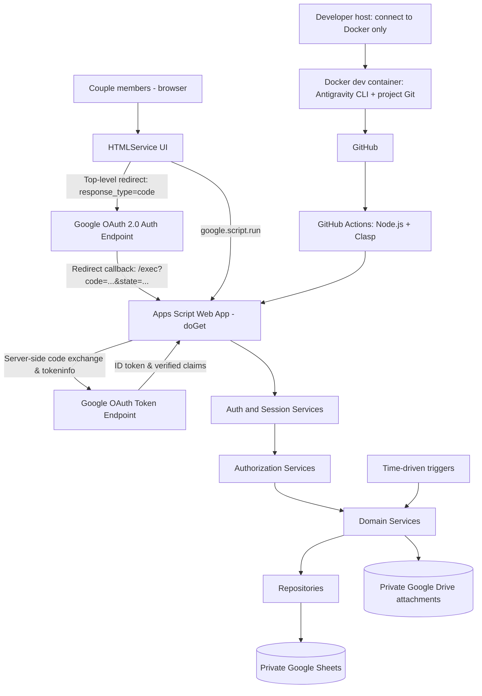

# Architecture
# Personal & Family Finance Manager

- Status: Architecture baseline
- Runtime: Google Apps Script V8
- Database: Google Sheets
- UI: Apps Script HTMLService
- Authentication: Google OAuth 2.0 Authorization Code Flow (OpenID Connect) + server-side code exchange & ID token verification
- No Cloud Run

## 1. Architecture decisions

| Concern | Decision |
|---|---|
| Hosting | Apps Script Web App |
| Execution identity | Execute as deploying owner |
| Access setting | Prefer “Anyone with Google account” if offered; if only “Anyone” is available, enforce authentication on every application API |
| Identity provider | Google OAuth 2.0 (OpenID Connect scopes: `openid email profile`) |
| Redirect URI | Stable Apps Script Web App `/exec` URL (e.g. `https://script.google.com/macros/s/<DEPLOYMENT_ID>/exec`) |
| Code exchange & verification | Server-side code exchange via `UrlFetchApp` and ID token verification |
| Application session | Random opaque token; store only SHA-256 hash |
| Database | Private Google Spreadsheet |
| File storage | Private Google Drive folder |
| Authorization | Server-side household membership + role checks |
| Concurrency | LockService + operation journal + idempotency |
| Deployment | GitHub Actions only; Node.js and Clasp execute only in GitHub-hosted runners |
| Environment separation | Separate DEV and PROD script projects and spreadsheets |

## 2. High-level component diagram



## 3. Authentication design without Cloud Run

### 3.1 Rejection of GIS JavaScript Credential Flow & Rationale for OAuth 2.0 Authorization Code Flow
The previously attempted Google Identity Services (GIS) JavaScript credential flow was evaluated and explicitly rejected:
- Google Apps Script HtmlService serves client JavaScript within an iframe on dynamic subdomains of `script.googleusercontent.com`.
- Google Cloud Console requires exact, static Authorized JavaScript Origins and does not support dynamic subdomains or wildcard domains on `script.googleusercontent.com`.
- As a result, GIS cannot reliably validate JavaScript origins in deployed Apps Script Web Apps.
- The user explicitly requires that the entire application and authentication callback remain strictly on Google Apps Script URLs without introducing external domains, reverse proxies, Cloud Run, or additional application servers.

To fulfill these requirements securely, the application adopts the **Google OAuth 2.0 Authorization Code Flow** with OpenID Connect (`openid email profile`).

### 3.2 Callback URI Feasibility Gate Analysis

Before implementation, callback options were evaluated against security and operational criteria:

1. **Candidate A: Stable DEV Web App `/exec` URL (Preferred)**
   - Format: `https://script.google.com/macros/s/<DEPLOYMENT_ID>/exec`
   - Evaluation: Google Cloud Console explicitly accepts `/exec` URLs as Authorized Redirect URIs for Web Application clients. When Google redirects back to `/exec?code=...&state=...`, Apps Script dispatches the request directly to `doGet(e)`. The authorization code and state parameter are cleanly received in `e.parameter`, without requiring popup windows or secondary browser tabs.
   - Status: **Selected as the primary redirect URI**.

2. **Candidate B: Apps Script `/usercallback` Endpoint (Fallback)**
   - Format: `https://script.google.com/macros/d/<SCRIPT_ID>/usercallback`
   - Evaluation: Used historically by Apps Script libraries for third-party OAuth flows via popup windows. While accepted by Google Cloud Console, it normally presents a default Apps Script completion page rather than continuing the in-app Web App lifecycle.
   - Status: **Retained as an evaluated technical fallback**.

3. **Domain Constraints**:
   - Neither `script.googleusercontent.com` nor wildcard origins are used.
   - All redirects occur on the stable Google domain `script.google.com`.

### 3.3 Why not Session.getActiveUser()
The Web App executes as the deployer. For personal Gmail accounts, Apps Script may not expose the accessing user's email in this deployment context. `Session.getActiveUser().getEmail()` must not be treated as the primary identity mechanism.

### 3.4 Browser Login Flow (OAuth 2.0 Authorization Code Flow)
1. User visits the Web App at `https://script.google.com/macros/s/<DEPLOYMENT_ID>/exec`.
2. `doGet(e)` generates a random state token using `Utilities.getUuid()`, caches it in `CacheService` with a 10-minute TTL, and constructs the Google OAuth 2.0 authorization URL:
   ```text
   https://accounts.google.com/o/oauth2/v2/auth?client_id=...&redirect_uri=...&response_type=code&scope=openid%20email%20profile&state=...&prompt=select_account&access_type=online
   ```
3. The UI renders a clean "Sign in with Google" button with `target="_top"`.
4. When clicked, the browser navigates the top-level window directly to Google's authorization endpoint, allowing the user to select one of the two authorized household Gmail accounts.
5. Google prompts for user consent and redirects the top-level window back to `https://script.google.com/macros/s/<DEPLOYMENT_ID>/exec?code=...&state=...`.
6. Apps Script receives the HTTP GET request in `doGet(e)`.
7. `doGet(e)` validates the state parameter against `CacheService` (immediately consuming it once) and processes the authorization code.

#### 3.4.1 FFM-006 Proof of Concept Scope & Boundaries
The FFM-006 implementation verifies that:
1. The HtmlService page correctly loads in Apps Script.
2. The server generates an OAuth authorization URL with `response_type=code` and scopes `openid email profile`.
3. The browser navigates top-level to Google's authorization endpoint and returns to the Apps Script `/exec` URL.
4. The server-side state token is validated and consumed, preventing CSRF and replay.
5. Both personal Gmail accounts can complete the redirect and return.

#### 3.4.2 FFM-007 Server-Issued OAuth Challenge Architecture

FFM-007 establishes the cryptographic challenge infrastructure for the Google OAuth 2.0 Authorization Code Flow, securing the flow against CSRF, replay, code interception, and state tampering:

1. **Cryptographic Randomness & Token Generation (`OAuthChallenge.generateToken`)**:
   - Google Apps Script V8 provides `Utilities.getUuid()`, which generates RFC 4122 v4 UUIDs backed by Google's secure random generation (122 bits of pseudorandom entropy per call).
   - Each security token (`state`, `nonce`, and PKCE `code_verifier`) is generated independently by concatenating two distinct UUIDs with hyphens stripped, yielding 64 lowercase hexadecimal characters representing 244 bits of effective entropy.
   - Separate, independent random values are generated for `state`, `nonce`, and `code_verifier`. No security value is reused across functions.

2. **PKCE S256 Implementation (RFC 7636)**:
   - **Google Web Client Compatibility**: Google OAuth 2.0 authorization endpoints natively support PKCE with `code_challenge_method=S256` across all client types, including Web Server Applications.
   - **Verifier**: 64-character unreserved hex string (`[0-9a-f]`), strictly adhering to the RFC 7636 length requirement (43 to 128 characters).
   - **Challenge Calculation**: Hashed with SHA-256 via `Utilities.computeDigest(Utilities.DigestAlgorithm.SHA_256, verifier, Utilities.Charset.US_ASCII)` and Base64URL-encoded via `Utilities.base64EncodeWebSafe()`, with trailing `=` padding stripped per RFC 7636 Section 3.
   - **Confidentiality**: The `code_verifier` is stored strictly server-side in `CacheService` and is **never** transmitted to the browser, rendered in HTML/JavaScript, or included in authorization URLs or log output. Only the derived `code_challenge` and `code_challenge_method=S256` are sent to Google in the authorization request.

3. **Short-Lived Challenge Storage & Hash-Derived Keys**:
   - Challenge records are stored in `CacheService.getScriptCache()` with a 10-minute (600s) TTL (enforcing a minimum of 300s and maximum of 600s).
   - **Hashed Cache Keys**: The cache key is derived from a SHA-256 hash of the state parameter (`oauth_ch_<stateHash>`). Raw state tokens never appear as raw cache keys.
   - **Stored Record**: Contains `{ stateHash, nonce, codeVerifier, codeChallenge, createdAt, expiresAt }`. The authorization code is never stored in the challenge record.
   - **Cache Eviction Limitation & Fail-Closed Behavior**: Apps Script CacheService does not guarantee persistence for the full TTL (early eviction may occur). All cache misses, expired challenges, missing records, or lock timeouts **fail closed**, rejecting the callback with a generic, safe error (`invalid_state`) and prompting the user to start a new login attempt.

4. **Atomic One-Time Challenge Consumption (`OAuthChallenge.consume`)**:
   - To eliminate race conditions and replay attacks from duplicate concurrent callback requests, consumption is protected by `LockService.getScriptLock()`.
   - The handler acquires the script lock (waiting up to 10 seconds), checks the record in `CacheService`, validates expiration against `expiresAt`, immediately deletes the cache entry (`cache.remove(cacheKey)`), and releases the lock in a mandatory `finally` block.
   - Any concurrent or subsequent request with the same state encounters a cache miss and is rejected.

5. **Callback Validation (`AuthConfig.validateCallback`)**:
   - Mandatory `state` validation is enforced for **both** authorization code callbacks and Google OAuth error returns (e.g. `access_denied`).
   - If Google returns an error, the associated state is consumed first, and a sanitized, generic error message is presented without leaking query parameters or stack traces.
   - For valid callbacks, the challenge data (`nonce`, `codeVerifier`) is returned solely to the server-side callback handler for use in FFM-008.

6. **Security Boundaries & Exclusions for FFM-007**:
   - **No Code Exchange Yet**: Authorization code exchange via `UrlFetchApp` belongs strictly to FFM-008.
   - **No ID Token Verification**: Cryptographic and claims verification of the Google ID token against `challenge.nonce` belongs to FFM-008.
   - **No Application Sessions**: Session token issuance and storage in `USER_SESSIONS` belong to FFM-010.
   - Validating the OAuth challenge confirms CSRF and replay protection but does **NOT** authenticate the identity or grant access to application data.

#### 3.4.3 FFM-008 Authorization Code Exchange & OpenID Connect Verification Architecture

FFM-008 completes the server-side identity verification step by exchanging the authorization code and validating the OpenID Connect (OIDC) ID token:

1. **Server-Side Authorization Code Exchange (`OAuthToken.exchangeCode`)**:
   - The authorization code received in the `/exec` callback is exchanged via an HTTPS POST request directly to Google's token endpoint: `https://oauth2.googleapis.com/token`.
   - The exchange request uses `application/x-www-form-urlencoded` format with parameters:
     - `code`: The authorization code received from Google.
     - `client_id`: Configured Google OAuth 2.0 Web Client ID.
     - `client_secret`: Confidential Web Client secret retrieved from Script Properties (`OAUTH_CLIENT_SECRET` or common aliases `CLIENT_SECRET`, `GOOGLE_CLIENT_SECRET`, `OAUTH_SECRET`).
     - `redirect_uri`: Stable Web App `/exec` URL (bound directly into the server challenge record at creation time to guarantee character-for-character equality with the authorization request).
     - `grant_type`: `authorization_code`.
     - `code_verifier`: The high-entropy PKCE verifier retrieved from the server-side FFM-007 challenge record.
   - Executed via `UrlFetchApp.fetch()` with `followRedirects: false` and `muteHttpExceptions: true` to inspect HTTP response codes safely.
   - Any HTTP error or failure (e.g. `invalid_grant`, expired code, or PKCE verification failure) fails closed with a sanitized error message; codes are never automatically retried.

2. **Client Credential Security**:
   - `OAUTH_CLIENT_SECRET` is stored strictly in Apps Script Script Properties.
   - It is never tracked in Git, never embedded in HTML/JavaScript, never exposed via `getPublicConfig()`, and never logged.

3. **OpenID Connect ID Token Verification (`OAuthToken.verifyIdToken`)**:
   - The response from the token endpoint is parsed to extract the `id_token` JWT.
   - The JWT structure is validated to ensure exactly three non-empty components (`header.payload.signature`).
   - Base64URL decoding is performed safely using standard Apps Script `Utilities.base64Decode()` without external dependencies.
   - Header validation: Requires algorithm `RS256`, token type `JWT`, and valid key ID (`kid`).
   - Required claim validation:
     - **Issuer (`iss`)**: Must exactly match `https://accounts.google.com` or `accounts.google.com`.
     - **Audience (`aud`)**: Must exactly match the configured Google OAuth Web Client ID.
     - **Authorized Party (`azp`)**: If present, must match the configured Google OAuth Web Client ID.
     - **Expiration (`exp`)**: Must be in the future, with a 60-second clock skew tolerance.
     - **Issued At (`iat`)**: Must be in the past (with 60-second clock skew tolerance) and no older than 10 minutes (`MAX_TOKEN_AGE_SECONDS = 600`).
     - **Nonce (`nonce`)**: Must be present and strictly equal to the server-issued nonce from the consumed FFM-007 challenge record, preventing cross-session and token replay attacks.
     - **Subject (`sub`)**: Must be a non-empty string representing the immutable Google account identifier.
     - **Email (`email`) & Verification (`email_verified`)**: Requires valid email format and `email_verified === true`.

4. **Authenticity & Verification Model**:
   - The ID token is acquired directly from Google's token endpoint over authenticated server-to-server TLS using client credentials and the one-time PKCE `code_verifier`.
   - In accordance with OpenID Connect Core 1.0 Section 3.1.3.7 ("ID Token Validation") Rule 6, direct TLS communication with the Token Endpoint validates the issuer and token authenticity without relying on browser transport.
   - **Environment Limitation Statement (Apps Script V8)**: Google Apps Script V8 provides `Utilities.computeRsaSha256Signature()` for private-key signing, but does not provide a native public-key RSA signature verification function (`crypto.subtle` is unavailable in Apps Script V8). Pure-JS third-party RSA libraries are not introduced to preserve the zero-runtime-dependencies architecture. Therefore, local cryptographic RSA signature verification against Google's JWKS is not natively executable within Apps Script; the application's authentication model relies on direct server-to-server TLS authentication to Google's Token Endpoint, client secret authentication, PKCE S256 verification, one-time OIDC nonce validation, and strict claims validation. Production identity verification is not claimed to include local RSA signature verification.

5. **Verified Identity Object**:
   - Upon successful verification, a sanitized identity object is constructed containing strictly validated claims:
     `{ googleSub, email, emailVerified, name, picture, issuedAt, expiresAt, verifiedAt }`.
   - Access tokens, refresh tokens, ID tokens, client secrets, nonces, and code verifiers are never included in the identity object.
   - No tokens are returned to the browser or stored in `localStorage`, `sessionStorage`, cookies, or Google Sheets.

6. **Account Allowlist Authorization (FFM-009)**:
   - Following successful OIDC verification, `AuthConfig.validateCallback()` passes the verified identity directly to `AuthAllowlist.authorize(identity)`.
   - **Configuration Storage**: Configured via Script Properties (`ALLOWED_EMAILS` / `ALLOWED_GOOGLE_SUBS`). Stored exclusively on the server; never exposed to client-side scripts, HTML templates, or Git repositories.
   - **Matching Policy**:
     - Fails closed if Script Properties are unconfigured, empty, or contain only malformed entries (`allowlist_unconfigured`).
     - Supports exact, case-insensitive email matching (`identity.email.toLowerCase() === allowedEmail.toLowerCase()`).
     - Mandates `identity.emailVerified === true` for email-based authorization.
     - Strict rejection of substring, prefix, suffix, and domain/wildcard matching.
     - Email aliases (e.g., `user+alias@gmail.com`) are rejected unless explicitly listed in configuration.
     - Supports stable Google `sub` matching via `ALLOWED_GOOGLE_SUBS` without falling back to unverified fields if sub is missing.
   - **Information Leakage Prevention**:
     - Denials return a generic safe message: `"This Google account is not authorized to access the application."`
     - Allowlist entries, configuration keys, other user identities, and OAuth tokens are never leaked to the client.
     - Unauthorized attempts do not create sessions and do not write to Google Sheets.
   - **Task Boundary**:
     - No application session is issued (FFM-010).
     - No household financial data is read or written.

### 3.4 Nonce and replay protection
- `getLoginConfig()` creates a cryptographically random nonce using Apps Script Utilities.
- Store a nonce hash with a short TTL (for example, 5 minutes) in a server-side store.
- The nonce is bound to a one-time login attempt.
- The ID token must contain the same nonce.
- Consume the nonce exactly once under a script lock.
- If nonce storage is missing, expired, already consumed, or cannot be checked, fail closed.
- CacheService may evict entries early; early eviction must cause login failure, not bypass. For stronger one-time semantics, use a small `LOGIN_NONCES` sheet or Script Properties with expiry and lock, and periodically clean expired records.
- Never accept a nonce supplied by the browser without matching a server-issued record.

### 3.5 Account allowlist configuration and operational instructions
- **Configuring Authorized DEV Accounts**:
  1. Open Apps Script Editor > Project Settings > Script Properties.
  2. Add property `ALLOWED_EMAILS` with comma-separated personal Gmail addresses of the household members (e.g. `owner@gmail.com, partner@gmail.com`).
  3. Optionally, add `ALLOWED_GOOGLE_SUBS` with comma-separated Google `sub` identifiers.
  4. Changes take effect immediately without modifying or redeploying code.
- **Adding or Removing an Authorized Account**:
  - To add an account: Append the new email/sub to `ALLOWED_EMAILS` or `ALLOWED_GOOGLE_SUBS` in Script Properties.
  - To remove an account: Delete the email/sub from the property. Next time the user attempts OAuth login, access will be denied immediately.
- **Missing or Malformed Configuration**:
  - Missing property: Returns `allowlist_unconfigured` and fails closed (denies all accounts).
  - Empty or whitespace property: Returns `allowlist_unconfigured` and fails closed.
  - Malformed property (e.g. invalid string without `@`): Filtered by `parseList`; if no valid addresses remain, fails closed.
- **Operational & Security Considerations**:
  - Allowlist authorization in FFM-009 gates entry at the application perimeter.
  - In FFM-012/013, authorized identities will be mapped to registered household records in the `USERS` sheet with role-based access control (OWNER/PARTNER).
  - Pre-register the two users in `USERS` using verified `google_sub` values.
  - Do not auto-create users based solely on email. Email can change; `google_sub` is the stable Google identity.
  - Require `status = ACTIVE` and active household membership.

### 3.6 Application session management (FFM-010)
1. **Session Architecture & Token Generation (`AuthSession.generateSessionToken`)**:
   - Generates at least 256 bits of cryptographically secure random token material. Concatenates three RFC 4122 v4 UUIDs without hyphens to provide 366 bits of entropy (96-character lowercase hex string). `Math.random()` is strictly prohibited.
   - Raw session tokens are opaque bearer credentials returned to the client **only once** upon successful session creation.
   - Raw tokens are never logged, never stored in URLs, never exposed in error messages, and never stored in plaintext on the server.

2. **Server-Side Storage & Hashing Policy**:
   - The server stores only the SHA-256 cryptographic digest of the session token (`AuthSession.hashToken()`, 64 hex characters).
   - Storage Key: `sess_<tokenHash>`.
   - Primary Persistent Store: `PropertiesService.getScriptProperties()`. Protects against early cache eviction and ensures durability across script execution containers for the 2-member household model.
   - Read-Through Cache: `CacheService.getScriptCache()`. Provides sub-millisecond session validation response times, backed by `PropertiesService` persistence on cache misses.
   - Record Structure: `{ sessionId, tokenHash, googleSub, email, name, picture, createdAt, lastSeenAt, expiresAt, status }`.
   - Concurrency Control: `LockService.getScriptLock()` is acquired during session creation to eliminate race conditions and partial writes.

3. **Session Lifetimes & Expiration Policy**:
   - **Absolute Maximum Lifetime**: 12 hours (43,200 seconds), configurable via `SESSION_LIFETIME_SECONDS`. When reached, the session expires immediately; reauthentication is mandatory.
   - **Idle Timeout**: 30 minutes (1,800 seconds), configurable via `SESSION_IDLE_TIMEOUT_SECONDS`. If `now - lastSeenAt >= 1800s`, the session expires.
   - **No Implicit Lifetime Extension / No Refresh Tokens**: Absolute lifetime is strictly finite and server-enforced; session renewal does not extend the 12-hour expiration cap and does not store or use Google OAuth refresh tokens.

4. **Session Validation (`AuthSession.validateSession`)**:
   - Performs format validation (requires valid hex string of >= 64 characters).
   - Computes SHA-256 digest of presented token and fetches record from cache / properties.
   - Performs **constant-time string comparison** (`constantTimeEquals`) between record hash and derived hash to mitigate timing attacks.
   - Validates that `status === 'ACTIVE'`.
   - Validates that `now < expiresAt` and `now - lastSeenAt < idleTimeout`.
   - Throttles persistent `lastSeenAt` timestamp updates (at most once every 60 seconds) to conserve Script Properties write quotas while keeping cache timestamps live.
   - Returns minimal safe authenticated identity: `{ valid: true, sessionId, googleSub, email, name, createdAt, expiresAt, lastSeenAt }`.

5. **Client-Side Storage & Transport Policy**:
   - Stored in browser `sessionStorage` (tab-scoped memory) or in-memory variables.
   - Persisting bearer tokens in `localStorage` is prohibited.
   - Communicates with server via `google.script.run` entry point (`apiValidateSession(token)`).
   - Browser identity claims (e.g. submitted `user_id` or `email`) are never trusted; identity is resolved strictly from the verified server-side session record.

6. **Task Boundaries**:
   - FFM-010 establishes and validates application sessions.
   - Logout, session revocation, and multi-device revocation belong to FFM-011.
   - Household context resolution and role-based authorization (OWNER/PARTNER) belong to FFM-012.

### 3.6.1 Logout, session revocation, and expiration handling (FFM-011)

1. **Server-Side Session Revocation (`AuthSession.revokeSession`)**:
   - Accepts the raw session token from the client via `apiLogout(token)`.
   - Derives the SHA-256 hash using `AuthSession.hashToken()` (same lookup as `validateSession`).
   - Immediately removes the session entry from `CacheService` to prevent stale cache hits.
   - Acquires `LockService.getScriptLock()` (5-second timeout) before modifying persistent storage.
   - Loads the session record from `PropertiesService` and sets `status = 'REVOKED'` with a `revokedAt` timestamp.
   - Writes the updated record back to `PropertiesService`.
   - `validateSession` already rejects any record with `status !== 'ACTIVE'`, so revoked sessions fail validation immediately.

2. **Idempotent and Safe Revocation**:
   - Revoking an already-revoked session returns `{ success: true, revoked: false, code: 'already_revoked' }` without modifying `revokedAt` or restoring the session.
   - Revoking an unknown token returns `{ success: true, revoked: false, code: 'not_found' }`.
   - Missing, empty, or malformed tokens return `{ success: true, revoked: false, code: 'missing_session' | 'malformed_session' }`.
   - Corrupted or invalid records are removed.
   - Lock timeout returns `{ success: false, error: 'lock_timeout' }` (fail-closed).

3. **Frontend Logout Flow**:
   - User clicks the "Sign Out / Log Out" button.
   - Client reads the session token from `sessionStorage` (`ffm_app_session_token`).
   - Client calls `google.script.run.apiLogout(token)` to revoke the server-side session.
   - On success or failure, client clears `sessionStorage.removeItem('ffm_app_session_token')`.
   - Client redirects to the Web App redirect URI (login page) via `window.top.location.href`.
   - If `google.script.run` is unavailable (e.g., non-HtmlService context), client clears the token and redirects immediately.

4. **Network Failure During Logout**:
   - If the server revocation call fails, the client still clears the local session token and redirects to the login page.
   - The user cannot continue using the authenticated UI state.
   - The server-side session may remain ACTIVE until it expires naturally (12-hour absolute lifetime or 30-minute idle timeout).
   - **Known limitation**: This is a safe degradation; the stale server-side session cannot be used by the client since the token is cleared from `sessionStorage`, which is tab-scoped.

5. **Session Expiration Enforcement**:
   - Absolute lifetime (12 hours) and idle timeout (30 minutes) remain enforced server-side by `validateSession`.
   - Expired sessions return `{ valid: false, error: 'expired_session' }`.
   - The client must clear the token from `sessionStorage` and return to the login page when session validation fails.
   - No automatic session renewal or extension.

6. **Security Invariants**:
   - Raw session tokens are never stored server-side, never logged, and never returned in revocation responses.
   - Token hashes and storage keys are never exposed to the client.
   - Revocation is irreversible; a revoked session cannot be reactivated.
   - Multiple logout requests on the same token are safe and idempotent.
   - No new session is automatically created after logout.

### 3.7 Critical limitation and go/no-go gate
Apps Script-only tokeninfo verification avoids Cloud Run and separate compute hosting, but introduces a dependency on Google's tokeninfo endpoint. It is not the same assurance/performance model as local JWT signature verification. Before production:
1. Build a minimal OAuth 2.0 Authorization Code Flow + HtmlService proof of concept.
2. Test both personal Gmail accounts.
3. Confirm the ID token includes the expected `aud`, `iss`, `exp`, `email_verified`, `sub`, and nonce.
4. Test invalid token, wrong audience, expired token, replayed nonce, and Google endpoint failure.
5. Confirm Apps Script UrlFetch authorization and deployment behavior.
6. Document the accepted residual risk.

If this proof of concept cannot reliably complete, stop and revisit the authentication architecture. Do not weaken verification by trusting email fields sent by the browser.

## 4. Authorization model

### 4.1 Roles
- `OWNER`: full household administration and all finance operations.
- `PARTNER`: all shared finance operations; cannot manage membership or owner security settings.

Both roles can view all transactions. No private transaction visibility is implemented.

### 4.2 Request context
Every protected service obtains the actor from `SessionService.requireSession(token)`. Never accept `user_id`, `role`, or `household_id` from the browser as authoritative values.

Resolve household membership server-side from the authenticated `user_id`. Validate every referenced account, category, transaction, bill, asset, and goal against the same household.

### 4.3 Service pipeline
1. Validate request shape and size.
2. Validate application session.
3. Resolve active user and household membership.
4. Check role/permission.
5. Validate business rules and record relationships.
6. Execute domain service.
7. Record audit event.
8. Return a minimal response; never return secrets or raw internal sheet data.

### 4.4 Example API pattern

```javascript
function apiCreateTransaction(sessionToken, payload) {
  const actor = AuthService.requireSession(sessionToken);
  const household = HouseholdAccessService.requireActiveHousehold(actor.userId);

  AuthorizationService.requirePermission(actor, 'transaction.create');

  TransactionValidator.validateCreate(payload, household.householdId);

  return TransactionService.create(actor, household, payload);
}
```

The browser must not choose the household or actor identity.

## 5. Data architecture

### 5.1 Spreadsheet ownership
- One spreadsheet per environment initially; one household per spreadsheet.
- Spreadsheet is owned by the deploying Google account.
- Do not share the production spreadsheet with either household member.
- Apps Script opens the spreadsheet using a server-side configured ID.
- Do not accept arbitrary spreadsheet IDs from browser calls.
- Protect sheets/ranges against accidental edits, while recognizing that protections are not a security boundary against the owner.

### 5.2 Repository pattern
Repositories own sheet access and batch I/O. Domain services own rules. Do not access SpreadsheetApp directly from UI functions.

Recommended layers:
- `Router` / public Apps Script functions.
- `AuthService`, `SessionService`.
- `AuthorizationService`, `HouseholdAccessService`.
- Domain services.
- Repositories.
- Database/schema/migration helpers.

### 5.3 Ledger invariants
- Ledger entries are the source of truth for balances.
- Balance = opening balance + posted IN - posted OUT.
- Transfers produce paired entries and do not count as income/expense.
- Only POSTED entries affect balance and budget actuals.
- Posted transactions are corrected by reversal/void, not physical deletion.
- All amounts are positive integer IDR; entry type conveys direction.
- Validate split sum equals transaction total.
- Never use floating-point arithmetic for financial calculations.

### 5.4 Posting safety
Google Sheets does not provide multi-sheet ACID transactions. Therefore:
- Acquire `LockService.getScriptLock()` for critical posting.
- Require a unique idempotency key.
- Write an operation journal record before ledger mutation.
- Track operation states (`PENDING`, `COMMITTED`, `FAILED`, `NEEDS_REVIEW`).
- Make each write/recovery step idempotent.
- Reconcile incomplete operations before retry.
- Do not automatically retry an ambiguous partial write without checking existing entries.
- Keep a periodic reconciliation job.

## 6. Drive attachments
- Store attachments in a private folder owned by the deploying account.
- Do not create public/anyone links.
- Store Drive file IDs, not public URLs.
- Check application session and household access before serving attachment content.
- Validate MIME type, file size, and filename.
- Never trust a client-supplied Drive folder ID.
- Do not expose Drive API credentials or file access tokens.

## 7. Configuration and secrets

Use Script Properties for environment configuration:
- `APP_ENV`
- `DB_SPREADSHEET_ID`
- `GOOGLE_OAUTH_CLIENT_ID`
- `ATTACHMENTS_FOLDER_ID`
- `AUTH_TOKENINFO_URL` (constant/default; not user-controlled)

Use GitHub Actions secrets for Clasp CI credentials. Do not commit `.clasprc.json`, script IDs for private environments if policy requires secrecy, OAuth client secrets, or session material.

An OAuth client ID is not a secret, but it must be correctly restricted/configured. Never put an OAuth client secret in browser HTML.

## 8. Development and deployment tooling boundary

The GitHub repository is the only source of truth. Apps Script V8 remains the server-side application runtime; it is distinct from Node.js. Node.js is used only as a GitHub Actions runner tool.

Docker development container (mandatory agent workspace):
- Antigravity CLI runs inside the configured Docker development container.
- Canonical project root: `/var/www/gas/personal_finance_v2/family-finance-antigravity`.
- All source/documentation edits, repository inspection, Git operations, and permitted project commands run inside this container from that project root.
- At the start of every agent session/task, verify `pwd` and `git rev-parse --show-toplevel`; stop if the canonical root does not match exactly.
- The host is only a connection point. Do not run the agent or project commands from the host, another container, or an alternate checkout. Do not guess container names or create replacement containers.
- Do not install or execute Node.js, npm, npx, or Clasp in this container or on the host.
- Do not run `clasp push`, `clasp deploy`, or `clasp status` here.
- Do not make direct production changes in the Apps Script editor. Emergency console changes require an explicit incident procedure and must be reconciled back into Git immediately.

GitHub Actions:
- Runs on GitHub-hosted runners.
- Sets up the approved Node.js LTS version.
- Installs development/test tools and Clasp in the runner only.
- Runs lint, syntax checks, unit tests, and security checks.
- Creates environment-specific `.clasp.json` at runtime using protected GitHub variables/secrets.
- Authenticates Clasp using GitHub Actions secrets.
- Pushes source to the DEV Apps Script project from the development branch.
- Deploys production only from protected `main`, after required approvals/checks.
- Uses concurrency groups to prevent overlapping deployments.
- Runs a post-deployment smoke check where practical.

Do not commit `.clasprc.json`, Clasp authentication material, generated environment-specific `.clasp.json` files containing private project IDs if repository policy treats them as sensitive, or production secrets. The CI workflow should generate environment-specific Clasp configuration at runtime.

The `package.json` is a manifest for CI tooling and test scripts only. It does not add any frontend runtime dependency. Its scripts are executed in GitHub Actions, not in the Docker development container or on the host.

## 9. Deployment

- Separate DEV and PROD Apps Script projects.
- Separate DEV and PROD spreadsheets and Drive attachment folders.
- Use separate Script Properties per environment.
- Use Clasp to push source.
- Deploy production only from protected `main`.
- Update the existing stable deployment ID to preserve Web App URL.
- Use GitHub Actions concurrency group to serialize production deployment.
- Run tests and checks before deployment.
- Smoke-test the deployed version after deployment.
- Have a documented rollback to the previous Apps Script version.

### 9.1 DEV Synchronization Workflow (`dev-sync.yml`)

The DEV synchronization workflow (`.github/workflows/dev-sync.yml`) automates synchronizing source code to the Google Apps Script DEV project:

1. **Triggers**:
   - Automatic execution on pushes to `develop` or `dev` branches.
   - Manual execution via `workflow_dispatch` (with branch guard preventing accidental execution against `main` unless explicitly forced).
2. **Prerequisites & CI Verification**:
   - Checks out the repository and configures Node.js 20 LTS in the GitHub-hosted runner.
   - Runs full CI verification prior to deployment: Apps Script manifest validation, syntax checking, ESLint static analysis, and Node.js unit tests.
   - If any CI check fails, execution terminates immediately with zero modification to the remote Apps Script project.
3. **Clasp Installation & Runtime Configuration**:
   - Clasp CLI (`@google/clasp@^2.4.2`) is installed exclusively inside the ephemeral GitHub Actions runner.
   - Credentials are read from GitHub Actions secrets (`CLASP_DEV_CLASPRC_JSON` or `CLASPRC_JSON`) and written to `$HOME/.clasprc.json` with `chmod 600`.
   - Script ID is retrieved from secrets or variables (`CLASP_DEV_SCRIPT_ID` or `DEV_SCRIPT_ID`).
   - A temporary `.clasp.json` is generated dynamically at repository root with `rootDir: "."` and mode `600`.
4. **Push Execution**:
   - Runs `clasp push --force` to push project files respecting `.claspignore` (ignoring CI workflows, tests, documentation, tool configs, and prompt files).
5. **Cleanup & Safety**:
   - Temporary `$HOME/.clasprc.json` and `.clasp.json` are unconditionally removed in a post-execution step (`if: always()`).
   - Workflow concurrency (`dev-sync` with `cancel-in-progress: false`) ensures deployments are serialized and prevents concurrent race conditions.
   - Least privilege GitHub token permissions (`contents: read`).

### 9.2 Required Secrets and Variables for DEV Sync

| Name | Type | Purpose |
|---|---|---|
| `CLASP_DEV_CLASPRC_JSON` (or `CLASPRC_JSON`) | GitHub Secret | Full JSON contents of `~/.clasprc.json` containing OAuth tokens (`access_token`, `refresh_token`, `clientId`, `clientSecret`) for Clasp authentication. |
| `DEV_SCRIPT_ID` (or `CLASP_DEV_SCRIPT_ID`) | GitHub Secret or Variable | Google Apps Script Script ID for the DEV project (found under Apps Script *Project Settings*). |

### 9.3 Production Deployment Workflow (`deploy-prod.yml`)

The Production deployment workflow (`.github/workflows/deploy-prod.yml`) provides a guarded, manual release mechanism adapted for the GitHub Free Plan:

1. **GitHub Free Plan Adaptation**:
   - Operates without GitHub Protected Environments, environment required reviewers, or paid approval gates.
   - Enforces operational safety through strict manual triggers (`workflow_dispatch`), triple-guard branch verification, automated CI gates, and deployment serialization.
2. **Trigger & Branch Validation**:
   - Manual execution only via `workflow_dispatch`.
   - Never triggers automatically on push, merge, or pull request events.
   - Requires explicit execution confirmation by an authorized maintainer.
   - **Triple-Layer Branch Guard**:
     - *Step 1*: Verifies `github.ref == 'refs/heads/main'`; halts immediately if invoked from any other branch.
     - *Step 2*: Performs checkout explicitly at `refs/heads/main` with `fetch-depth: 0`.
     - *Step 3*: Verifies the checked-out commit belongs to `origin/main` via `git branch -r --contains`.
3. **Pre-flight Configuration Verification**:
   - Validates that `PROD_CLASP_CREDENTIALS`, `PROD_SCRIPT_ID`, and `PROD_DEPLOYMENT_ID` are non-empty and not placeholder values.
   - Strictly isolated: never falls back to DEV script IDs, DEV credentials, or default values.
   - Halts immediately before installing Clasp or modifying files if any configuration is missing.
4. **CI Verification Against Exact Commit**:
   - Sets up Node.js 20 LTS and installs dependencies.
   - Executes full CI suite: Apps Script manifest validation, syntax checking, ESLint static analysis, and Node.js unit tests against the exact commit being deployed.
   - Fails closed: any validation failure aborts the deployment prior to running `clasp push`.
5. **Runtime Clasp Configuration & Push**:
   - Installs `@google/clasp@^2.4.2` exclusively in the ephemeral GitHub Actions runner.
   - Writes credentials to `$HOME/.clasprc.json` with mode `600` and validates JSON structure without logging tokens.
   - Generates temporary `.clasp.json` containing `PROD_SCRIPT_ID` and `rootDir: "."` with mode `600`.
   - Executes `clasp push --force` respecting `.claspignore`.
6. **Preservation of Stable Web App URL**:
   - Updates the existing deployment using:
     ```bash
     clasp deploy -i "$PROD_DEPLOYMENT_ID" -d "$RELEASE_DESCRIPTION"
     ```
   - Preserves the stable production Web App URL without generating duplicate deployment IDs.
   - Never creates a new deployment ID automatically for routine releases.
7. **Concurrency & Cleanup**:
   - Concurrency group `production-deploy` with `cancel-in-progress: false` serializes releases and prevents overlapping deployments.
   - Least privilege GitHub token permissions (`contents: read`).
   - Unconditional cleanup (`if: always()`) purges `$HOME/.clasprc.json` and `.clasp.json`.

### 9.4 Required Secrets and Variables for Production Deployment

Configured as GitHub repository secrets/variables (not environment secrets):

| Name | Type | Purpose |
|---|---|---|
| `PROD_CLASP_CREDENTIALS` (or `PROD_CLASPRC_JSON`) | GitHub Secret | Full JSON contents of `~/.clasprc.json` containing OAuth credentials for the production deployer Google account. |
| `PROD_SCRIPT_ID` | GitHub Secret or Variable | Google Apps Script Script ID for the Production project. |
| `PROD_DEPLOYMENT_ID` | GitHub Secret or Variable | Existing stable deployment ID of the Production Web App deployment (ensures URL stability). |

### 9.5 Repository Access Protection & Operational Recommendations

Given the GitHub Free Plan constraint (absence of automated multi-party approval gates):
- **Access Control**: Restrict repository `Write` and `Admin` permissions to trusted maintainers only.
- **Branch Protection**: Protect `main` against direct pushes in GitHub repository settings where available; require Pull Requests and passing CI checks before merging.
- **Code Review**: Conduct thorough code and security reviews on development branches (`dev`/`develop`) before merging to `main`.
- **Credential Isolation**: Store production credentials exclusively in GitHub Actions Secrets; never expose production secrets to pull request workflows.
- **Procedural Limitation**: Manual `workflow_dispatch` is an operational procedural check and does not provide the same security guarantees as an automated required-reviewer approval gate. Maintainers must exercise deliberate review prior to dispatching production deployments.

### 9.6 Mandatory Pre-Deployment Checklist

Before deploying to any environment (DEV or PROD), verify the following Script Properties are configured in the target Apps Script project:

| Script Property | Required | Purpose | Expected Format |
|---|---|---|---|
| `OAUTH_CLIENT_ID` | Yes | Google OAuth 2.0 Web Client ID | `<id>.apps.googleusercontent.com` |
| `OAUTH_CLIENT_SECRET` | Yes | Google OAuth 2.0 Client Secret | Obtained from Google Cloud Console |
| `OAUTH_REDIRECT_URI` | Recommended | Explicit redirect URI override | `https://script.google.com/macros/s/<DEPLOYMENT_ID>/exec` |
| `ALLOWED_EMAILS` | **Yes** | Comma-separated list of authorized household member Gmail addresses | `owner@gmail.com, partner@gmail.com` |
| `ALLOWED_GOOGLE_SUBS` | Optional | Comma-separated Google `sub` identifiers for immutable identity matching | `1234567890, 0987654321` |
| `SESSION_LIFETIME_SECONDS` | Optional | Absolute session lifetime (default: 43200 = 12 hours) | Integer seconds |
| `SESSION_IDLE_TIMEOUT_SECONDS` | Optional | Session idle timeout (default: 1800 = 30 minutes) | Integer seconds |

**Critical**: If `ALLOWED_EMAILS` is missing or empty, the application fails closed with `allowlist_unconfigured` and **all login attempts are denied**. This is by design to prevent unauthorized access.

Verification steps:
1. Open the target Apps Script project in the Apps Script Editor.
2. Navigate to Project Settings > Script Properties.
3. Confirm each required property is present, non-empty, and correctly formatted.
4. For `ALLOWED_EMAILS`, verify only the two authorized household Gmail addresses are listed.
5. After deployment, test login with both authorized accounts.
6. Test login with an unauthorized account to confirm denial.

## 10. Monitoring, backup, and operations
- Log operational event IDs, function names, duration, outcome, and correlation IDs.
- Redact tokens, passwords, PII not needed for diagnosis, and financial payloads.
- Monitor Apps Script execution failures and quotas.
- Daily backup and periodic restore test.
- Keep backup copies in a separate restricted Drive location.
- Document owner account recovery and transfer procedure.
- Keep a manual ledger reconciliation report.

## 11. Scaling boundary
This design is for a very small household application. Google Sheets is not a transactional database. Revisit the storage architecture if concurrent use, data volume, audit requirements, or financial criticality exceed what Sheets can safely support.
