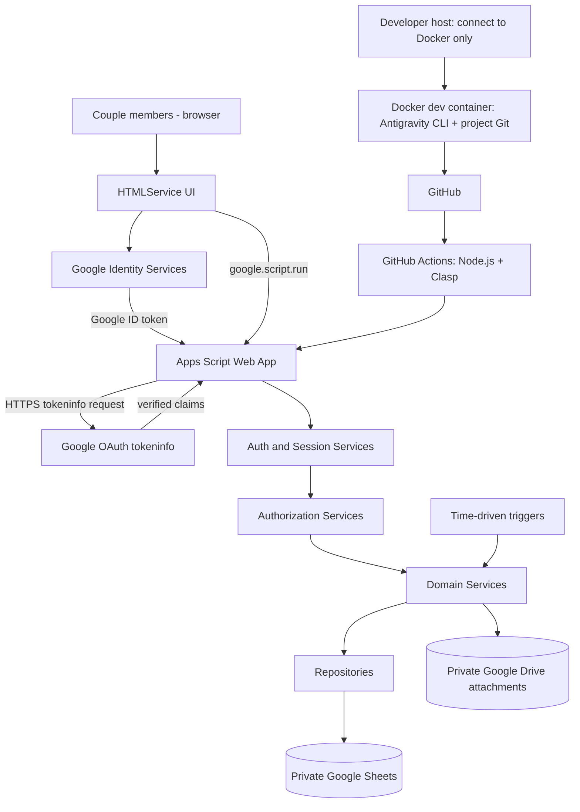

# Architecture
# Personal & Family Finance Manager

- Status: Architecture baseline
- Runtime: Google Apps Script V8
- Database: Google Sheets
- UI: Apps Script HTMLService
- Authentication: Google Identity Services (GIS) + Google token verification endpoint called by Apps Script
- No Cloud Run

## 1. Architecture decisions

| Concern | Decision |
|---|---|
| Hosting | Apps Script Web App |
| Execution identity | Execute as deploying owner |
| Access setting | Prefer “Anyone with Google account” if offered; if only “Anyone” is available, enforce authentication on every application API |
| Identity provider | Google Identity Services |
| Token verification | Apps Script calls Google's `https://oauth2.googleapis.com/tokeninfo` endpoint server-side |
| Application session | Random opaque token; store only SHA-256 hash |
| Database | Private Google Spreadsheet |
| File storage | Private Google Drive folder |
| Authorization | Server-side household membership + role checks |
| Concurrency | LockService + operation journal + idempotency |
| Deployment | GitHub Actions only; Node.js and Clasp execute only in GitHub-hosted runners |
| Environment separation | Separate DEV and PROD script projects and spreadsheets |

## 2. High-level component diagram



## 3. Authentication design without Cloud Run

### 3.1 Why not Session.getActiveUser()
The Web App executes as the deployer. For personal Gmail accounts, Apps Script may not expose the accessing user's email in this deployment context. `Session.getActiveUser().getEmail()` must not be treated as the primary identity mechanism.

### 3.2 Browser login
- Configure a Google OAuth 2.0 Web application client ID in Google Cloud Console.
- Configure authorized JavaScript origins required by the actual HtmlService deployment (typically the sandbox origin displayed on the diagnostic card, such as `https://<script-id>.script.googleusercontent.com` or `https://script.google.com`).
- Store the Web Client ID in Apps Script Script Properties as `GIS_CLIENT_ID` (or `GOOGLE_OAUTH_CLIENT_ID`). Never hardcode or commit OAuth Client IDs or secrets.
- Load Google Identity Services client library in the HTMLService page (`https://accounts.google.com/gsi/client`).
- Inject public configuration into HtmlService template at runtime via `src/ui/webapp.js` (`doGet`).
- Render the official Google Sign-In button using `google.accounts.id.renderButton`.
- Receive the credential response via the GIS JavaScript client callback (`handleCredentialResponse`).
- Do not treat the decoded browser payload as trusted proof of identity.
- Do not log, display in DOM, or persist the ID token in `localStorage`, `sessionStorage`, `cookies`, or Google Sheets.
- Display a clear, safe success message indicating receipt of the credential response, accompanied by an explicit notice that frontend credential receipt does NOT constitute application authentication.

Important deployment validation: HtmlService runs in a sandboxed iframe and GIS origin behavior must be tested against the actual deployed URL. Do not assume that adding the script URL as an OAuth origin is sufficient. Complete a proof-of-concept login with both Gmail accounts before implementing the rest of the app.

#### 3.2.1 FFM-006 Proof of Concept Scope & Boundaries
The FFM-006 implementation verifies that:
1. The HtmlService page correctly loads in Apps Script.
2. The GIS client library initializes and renders the Google Sign-In button.
3. The browser callback receives a Google ID credential response upon user sign-in.

**Security Boundaries & Exclusions:**
- **No Server-Side Verification:** Token signature, audience (`aud`), issuer (`iss`), expiration (`exp`), and email verification claims are not yet validated.
- **No Replay Protection:** Server-issued login nonces are not yet implemented (scheduled for FFM-007).
- **No Allowlist Authorization:** The user allowlist restricting access to the two registered Google `sub` accounts is not yet enforced (scheduled for FFM-009).
- **No Application Sessions:** Session token issuance, storage, and validation are not yet active (scheduled for FFM-010).
- Receiving a GIS credential in this proof of concept does **NOT** grant access or authenticate the user into the application.

### 3.3 Server-side verification using Google's tokeninfo endpoint
Apps Script calls:

```text
GET https://oauth2.googleapis.com/tokeninfo?id_token=<URL-encoded-ID-token>
```

Use `UrlFetchApp.fetch()` with bounded timeout where supported and inspect the HTTP status. Treat any network failure, non-2xx response, malformed JSON, or missing claim as authentication failure. Do not fall back to trusting client-supplied claims.

Validate at minimum:
- `aud` exactly equals the configured OAuth Client ID.
- `iss` is an accepted Google issuer (`accounts.google.com` or `https://accounts.google.com`).
- `exp` is in the future, with a small clock-skew allowance.
- `iat` is plausible and token is sufficiently fresh.
- `email_verified` is true.
- `email` is one of the pre-approved accounts.
- `sub` is present and matches the registered identity.
- `nonce` equals a server-issued, unused nonce.

`tokeninfo` is a Google verification/introspection endpoint and is commonly documented for inspection/testing. It adds a network dependency and latency, and should be treated as a pragmatic small-scale design rather than equivalent to locally verifying JWT signatures. Monitor its reliability and quotas. If the app later becomes business-critical or grows, move to a backend that verifies JWT signatures locally.

### 3.4 Nonce and replay protection
- `getLoginConfig()` creates a cryptographically random nonce using Apps Script Utilities.
- Store a nonce hash with a short TTL (for example, 5 minutes) in a server-side store.
- The nonce is bound to a one-time login attempt.
- The ID token must contain the same nonce.
- Consume the nonce exactly once under a script lock.
- If nonce storage is missing, expired, already consumed, or cannot be checked, fail closed.
- CacheService may evict entries early; early eviction must cause login failure, not bypass. For stronger one-time semantics, use a small `LOGIN_NONCES` sheet or Script Properties with expiry and lock, and periodically clean expired records.
- Never accept a nonce supplied by the browser without matching a server-issued record.

### 3.5 Account allowlist and user registration
- Pre-register the two users in `USERS` using verified `google_sub` values.
- Do not auto-create users based solely on email.
- Email can change; `google_sub` is the stable Google identity.
- Verify the Google `sub` and email mapping against the registered user.
- Require `status = ACTIVE` and active household membership.

### 3.6 Application session
- Generate at least 256 bits of cryptographically secure random token material.
- Return the raw opaque token once to the browser.
- Store only SHA-256 token hash in `USER_SESSIONS`.
- Session policy baseline: 12-hour absolute lifetime, 30-minute idle timeout.
- Use server-side checks on every protected API call.
- Revoke session on logout; support OWNER revocation.
- Do not put session tokens in URLs or logs.
- Prefer in-memory browser storage; a page reload can require reauthentication. Do not persist bearer session tokens in localStorage.
- Apply CSRF/origin protections appropriate to the chosen `google.script.run` transport and do not create an unauthenticated generic JSON mutation endpoint.

### 3.7 Critical limitation and go/no-go gate
Apps Script-only tokeninfo verification avoids Cloud Run and separate compute hosting, but introduces a dependency on Google's tokeninfo endpoint. It is not the same assurance/performance model as local JWT signature verification. Before production:
1. Build a minimal GIS + HtmlService proof of concept.
2. Test both personal Gmail accounts.
3. Confirm the ID token includes the expected `aud`, `iss`, `exp`, `email_verified`, `sub`, and nonce.
4. Test invalid token, wrong audience, expired token, replayed nonce, and Google endpoint failure.
5. Confirm Apps Script UrlFetch authorization and deployment behavior.
6. Document the accepted residual risk.

If this proof of concept cannot reliably complete, stop and revisit the authentication architecture. Do not weaken verification by trusting email fields sent by the browser.

## 4. Authorization model

### 4.1 Roles
- `OWNER`: full household administration and all finance operations.
- `PARTNER`: all shared finance operations; cannot manage membership or owner security settings.

Both roles can view all transactions. No private transaction visibility is implemented.

### 4.2 Request context
Every protected service obtains the actor from `SessionService.requireSession(token)`. Never accept `user_id`, `role`, or `household_id` from the browser as authoritative values.

Resolve household membership server-side from the authenticated `user_id`. Validate every referenced account, category, transaction, bill, asset, and goal against the same household.

### 4.3 Service pipeline
1. Validate request shape and size.
2. Validate application session.
3. Resolve active user and household membership.
4. Check role/permission.
5. Validate business rules and record relationships.
6. Execute domain service.
7. Record audit event.
8. Return a minimal response; never return secrets or raw internal sheet data.

### 4.4 Example API pattern

```javascript
function apiCreateTransaction(sessionToken, payload) {
  const actor = AuthService.requireSession(sessionToken);
  const household = HouseholdAccessService.requireActiveHousehold(actor.userId);

  AuthorizationService.requirePermission(actor, 'transaction.create');

  TransactionValidator.validateCreate(payload, household.householdId);

  return TransactionService.create(actor, household, payload);
}
```

The browser must not choose the household or actor identity.

## 5. Data architecture

### 5.1 Spreadsheet ownership
- One spreadsheet per environment initially; one household per spreadsheet.
- Spreadsheet is owned by the deploying Google account.
- Do not share the production spreadsheet with either household member.
- Apps Script opens the spreadsheet using a server-side configured ID.
- Do not accept arbitrary spreadsheet IDs from browser calls.
- Protect sheets/ranges against accidental edits, while recognizing that protections are not a security boundary against the owner.

### 5.2 Repository pattern
Repositories own sheet access and batch I/O. Domain services own rules. Do not access SpreadsheetApp directly from UI functions.

Recommended layers:
- `Router` / public Apps Script functions.
- `AuthService`, `SessionService`.
- `AuthorizationService`, `HouseholdAccessService`.
- Domain services.
- Repositories.
- Database/schema/migration helpers.

### 5.3 Ledger invariants
- Ledger entries are the source of truth for balances.
- Balance = opening balance + posted IN - posted OUT.
- Transfers produce paired entries and do not count as income/expense.
- Only POSTED entries affect balance and budget actuals.
- Posted transactions are corrected by reversal/void, not physical deletion.
- All amounts are positive integer IDR; entry type conveys direction.
- Validate split sum equals transaction total.
- Never use floating-point arithmetic for financial calculations.

### 5.4 Posting safety
Google Sheets does not provide multi-sheet ACID transactions. Therefore:
- Acquire `LockService.getScriptLock()` for critical posting.
- Require a unique idempotency key.
- Write an operation journal record before ledger mutation.
- Track operation states (`PENDING`, `COMMITTED`, `FAILED`, `NEEDS_REVIEW`).
- Make each write/recovery step idempotent.
- Reconcile incomplete operations before retry.
- Do not automatically retry an ambiguous partial write without checking existing entries.
- Keep a periodic reconciliation job.

## 6. Drive attachments
- Store attachments in a private folder owned by the deploying account.
- Do not create public/anyone links.
- Store Drive file IDs, not public URLs.
- Check application session and household access before serving attachment content.
- Validate MIME type, file size, and filename.
- Never trust a client-supplied Drive folder ID.
- Do not expose Drive API credentials or file access tokens.

## 7. Configuration and secrets

Use Script Properties for environment configuration:
- `APP_ENV`
- `DB_SPREADSHEET_ID`
- `GOOGLE_OAUTH_CLIENT_ID`
- `ATTACHMENTS_FOLDER_ID`
- `AUTH_TOKENINFO_URL` (constant/default; not user-controlled)

Use GitHub Actions secrets for Clasp CI credentials. Do not commit `.clasprc.json`, script IDs for private environments if policy requires secrecy, OAuth client secrets, or session material.

An OAuth client ID is not a secret, but it must be correctly restricted/configured. Never put an OAuth client secret in browser HTML.

## 8. Development and deployment tooling boundary

The GitHub repository is the only source of truth. Apps Script V8 remains the server-side application runtime; it is distinct from Node.js. Node.js is used only as a GitHub Actions runner tool.

Docker development container (mandatory agent workspace):
- Antigravity CLI runs inside the configured Docker development container.
- Canonical project root: `/var/www/gas/personal_finance_v2/family-finance-antigravity`.
- All source/documentation edits, repository inspection, Git operations, and permitted project commands run inside this container from that project root.
- At the start of every agent session/task, verify `pwd` and `git rev-parse --show-toplevel`; stop if the canonical root does not match exactly.
- The host is only a connection point. Do not run the agent or project commands from the host, another container, or an alternate checkout. Do not guess container names or create replacement containers.
- Do not install or execute Node.js, npm, npx, or Clasp in this container or on the host.
- Do not run `clasp push`, `clasp deploy`, or `clasp status` here.
- Do not make direct production changes in the Apps Script editor. Emergency console changes require an explicit incident procedure and must be reconciled back into Git immediately.

GitHub Actions:
- Runs on GitHub-hosted runners.
- Sets up the approved Node.js LTS version.
- Installs development/test tools and Clasp in the runner only.
- Runs lint, syntax checks, unit tests, and security checks.
- Creates environment-specific `.clasp.json` at runtime using protected GitHub variables/secrets.
- Authenticates Clasp using GitHub Actions secrets.
- Pushes source to the DEV Apps Script project from the development branch.
- Deploys production only from protected `main`, after required approvals/checks.
- Uses concurrency groups to prevent overlapping deployments.
- Runs a post-deployment smoke check where practical.

Do not commit `.clasprc.json`, Clasp authentication material, generated environment-specific `.clasp.json` files containing private project IDs if repository policy treats them as sensitive, or production secrets. The CI workflow should generate environment-specific Clasp configuration at runtime.

The `package.json` is a manifest for CI tooling and test scripts only. It does not add any frontend runtime dependency. Its scripts are executed in GitHub Actions, not in the Docker development container or on the host.

## 9. Deployment

- Separate DEV and PROD Apps Script projects.
- Separate DEV and PROD spreadsheets and Drive attachment folders.
- Use separate Script Properties per environment.
- Use Clasp to push source.
- Deploy production only from protected `main`.
- Update the existing stable deployment ID to preserve Web App URL.
- Use GitHub Actions concurrency group to serialize production deployment.
- Run tests and checks before deployment.
- Smoke-test the deployed version after deployment.
- Have a documented rollback to the previous Apps Script version.

### 9.1 DEV Synchronization Workflow (`dev-sync.yml`)

The DEV synchronization workflow (`.github/workflows/dev-sync.yml`) automates synchronizing source code to the Google Apps Script DEV project:

1. **Triggers**:
   - Automatic execution on pushes to `develop` or `dev` branches.
   - Manual execution via `workflow_dispatch` (with branch guard preventing accidental execution against `main` unless explicitly forced).
2. **Prerequisites & CI Verification**:
   - Checks out the repository and configures Node.js 20 LTS in the GitHub-hosted runner.
   - Runs full CI verification prior to deployment: Apps Script manifest validation, syntax checking, ESLint static analysis, and Node.js unit tests.
   - If any CI check fails, execution terminates immediately with zero modification to the remote Apps Script project.
3. **Clasp Installation & Runtime Configuration**:
   - Clasp CLI (`@google/clasp@^2.4.2`) is installed exclusively inside the ephemeral GitHub Actions runner.
   - Credentials are read from GitHub Actions secrets (`CLASP_DEV_CLASPRC_JSON` or `CLASPRC_JSON`) and written to `$HOME/.clasprc.json` with `chmod 600`.
   - Script ID is retrieved from secrets or variables (`CLASP_DEV_SCRIPT_ID` or `DEV_SCRIPT_ID`).
   - A temporary `.clasp.json` is generated dynamically at repository root with `rootDir: "."` and mode `600`.
4. **Push Execution**:
   - Runs `clasp push --force` to push project files respecting `.claspignore` (ignoring CI workflows, tests, documentation, tool configs, and prompt files).
5. **Cleanup & Safety**:
   - Temporary `$HOME/.clasprc.json` and `.clasp.json` are unconditionally removed in a post-execution step (`if: always()`).
   - Workflow concurrency (`dev-sync` with `cancel-in-progress: false`) ensures deployments are serialized and prevents concurrent race conditions.
   - Least privilege GitHub token permissions (`contents: read`).

### 9.2 Required Secrets and Variables for DEV Sync

| Name | Type | Purpose |
|---|---|---|
| `CLASP_DEV_CLASPRC_JSON` (or `CLASPRC_JSON`) | GitHub Secret | Full JSON contents of `~/.clasprc.json` containing OAuth tokens (`access_token`, `refresh_token`, `clientId`, `clientSecret`) for Clasp authentication. |
| `DEV_SCRIPT_ID` (or `CLASP_DEV_SCRIPT_ID`) | GitHub Secret or Variable | Google Apps Script Script ID for the DEV project (found under Apps Script *Project Settings*). |

### 9.3 Production Deployment Workflow (`deploy-prod.yml`)

The Production deployment workflow (`.github/workflows/deploy-prod.yml`) provides a guarded, manual release mechanism adapted for the GitHub Free Plan:

1. **GitHub Free Plan Adaptation**:
   - Operates without GitHub Protected Environments, environment required reviewers, or paid approval gates.
   - Enforces operational safety through strict manual triggers (`workflow_dispatch`), triple-guard branch verification, automated CI gates, and deployment serialization.
2. **Trigger & Branch Validation**:
   - Manual execution only via `workflow_dispatch`.
   - Never triggers automatically on push, merge, or pull request events.
   - Requires explicit execution confirmation by an authorized maintainer.
   - **Triple-Layer Branch Guard**:
     - *Step 1*: Verifies `github.ref == 'refs/heads/main'`; halts immediately if invoked from any other branch.
     - *Step 2*: Performs checkout explicitly at `refs/heads/main` with `fetch-depth: 0`.
     - *Step 3*: Verifies the checked-out commit belongs to `origin/main` via `git branch -r --contains`.
3. **Pre-flight Configuration Verification**:
   - Validates that `PROD_CLASP_CREDENTIALS`, `PROD_SCRIPT_ID`, and `PROD_DEPLOYMENT_ID` are non-empty and not placeholder values.
   - Strictly isolated: never falls back to DEV script IDs, DEV credentials, or default values.
   - Halts immediately before installing Clasp or modifying files if any configuration is missing.
4. **CI Verification Against Exact Commit**:
   - Sets up Node.js 20 LTS and installs dependencies.
   - Executes full CI suite: Apps Script manifest validation, syntax checking, ESLint static analysis, and Node.js unit tests against the exact commit being deployed.
   - Fails closed: any validation failure aborts the deployment prior to running `clasp push`.
5. **Runtime Clasp Configuration & Push**:
   - Installs `@google/clasp@^2.4.2` exclusively in the ephemeral GitHub Actions runner.
   - Writes credentials to `$HOME/.clasprc.json` with mode `600` and validates JSON structure without logging tokens.
   - Generates temporary `.clasp.json` containing `PROD_SCRIPT_ID` and `rootDir: "."` with mode `600`.
   - Executes `clasp push --force` respecting `.claspignore`.
6. **Preservation of Stable Web App URL**:
   - Updates the existing deployment using:
     ```bash
     clasp deploy -i "$PROD_DEPLOYMENT_ID" -d "$RELEASE_DESCRIPTION"
     ```
   - Preserves the stable production Web App URL without generating duplicate deployment IDs.
   - Never creates a new deployment ID automatically for routine releases.
7. **Concurrency & Cleanup**:
   - Concurrency group `production-deploy` with `cancel-in-progress: false` serializes releases and prevents overlapping deployments.
   - Least privilege GitHub token permissions (`contents: read`).
   - Unconditional cleanup (`if: always()`) purges `$HOME/.clasprc.json` and `.clasp.json`.

### 9.4 Required Secrets and Variables for Production Deployment

Configured as GitHub repository secrets/variables (not environment secrets):

| Name | Type | Purpose |
|---|---|---|
| `PROD_CLASP_CREDENTIALS` (or `PROD_CLASPRC_JSON`) | GitHub Secret | Full JSON contents of `~/.clasprc.json` containing OAuth credentials for the production deployer Google account. |
| `PROD_SCRIPT_ID` | GitHub Secret or Variable | Google Apps Script Script ID for the Production project. |
| `PROD_DEPLOYMENT_ID` | GitHub Secret or Variable | Existing stable deployment ID of the Production Web App deployment (ensures URL stability). |

### 9.5 Repository Access Protection & Operational Recommendations

Given the GitHub Free Plan constraint (absence of automated multi-party approval gates):
- **Access Control**: Restrict repository `Write` and `Admin` permissions to trusted maintainers only.
- **Branch Protection**: Protect `main` against direct pushes in GitHub repository settings where available; require Pull Requests and passing CI checks before merging.
- **Code Review**: Conduct thorough code and security reviews on development branches (`dev`/`develop`) before merging to `main`.
- **Credential Isolation**: Store production credentials exclusively in GitHub Actions Secrets; never expose production secrets to pull request workflows.
- **Procedural Limitation**: Manual `workflow_dispatch` is an operational procedural check and does not provide the same security guarantees as an automated required-reviewer approval gate. Maintainers must exercise deliberate review prior to dispatching production deployments.

## 10. Monitoring, backup, and operations
- Log operational event IDs, function names, duration, outcome, and correlation IDs.
- Redact tokens, passwords, PII not needed for diagnosis, and financial payloads.
- Monitor Apps Script execution failures and quotas.
- Daily backup and periodic restore test.
- Keep backup copies in a separate restricted Drive location.
- Document owner account recovery and transfer procedure.
- Keep a manual ledger reconciliation report.

## 11. Scaling boundary
This design is for a very small household application. Google Sheets is not a transactional database. Revisit the storage architecture if concurrent use, data volume, audit requirements, or financial criticality exceed what Sheets can safely support.
