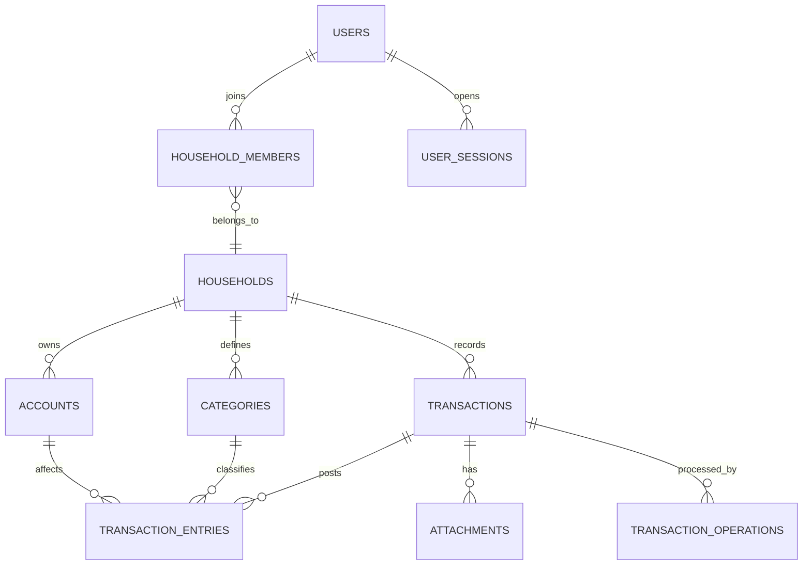

# Database Schema
# Personal & Family Finance Manager

- Storage: Google Sheets
- Scope: one household per spreadsheet
- Primary keys: UUID strings
- Currency: integer IDR
- Timestamps: ISO 8601 UTC strings; render in Asia/Jakarta
- Deletion: logical deactivation; posted financial records are never physically deleted

## 1. Conventions

Every entity uses:
- UUID primary key.
- `created_at`, `updated_at` where applicable.
- `created_by`, `updated_by` for user-created business records.
- Household-scoped records include `household_id`.
- Foreign keys are validated in repository/service code; Sheets does not enforce relational constraints.

Use header rows with exact stable column names. Do not use row numbers as identifiers. Do not rename or reorder columns without a migration.

Amounts are positive integer Rupiah. Never store formatted currency strings in numeric columns. Validate `Number.isSafeInteger(amount)` in JavaScript and enforce business maximums.

## 2. Worksheets

Recommended worksheets, in order:

| # | Worksheet | Purpose |
|---:|---|---|
| 01 | `USERS` | Registered Google identities |
| 02 | `HOUSEHOLD_MEMBERS` | Household membership and role |
| 03 | `ACCOUNTS` | Bank, e-wallet, cash, savings accounts |
| 04 | `CATEGORIES` | Income/expense categories |
| 05 | `TRANSACTIONS` | Transaction headers |
| 06 | `TRANSACTION_ENTRIES` | Ledger entries |
| 07 | `TRANSACTION_TAGS` | Transaction tags |
| 08 | `BUDGETS` | Budget periods |
| 09 | `BUDGET_ITEMS` | Category budget allocations |
| 10 | `RECURRING_RULES` | Recurring transaction rules |
| 11 | `BILLS` | Payables and due dates |
| 12 | `BILL_PAYMENTS` | Bill payment allocations |
| 13 | `SAVINGS_GOALS` | Savings targets |
| 14 | `GOAL_CONTRIBUTIONS` | Goal contribution history |
| 15 | `LIABILITIES` | Loans and debts |
| 16 | `DEBT_PAYMENTS` | Debt payment components |
| 17 | `ASSETS` | Non-financial assets |
| 18 | `ASSET_VALUATIONS` | Asset valuation history |
| 19 | `INVESTMENTS` | Investment instruments/positions |
| 20 | `INVESTMENT_TRANSACTIONS` | Investment trade history |
| 21 | `ATTACHMENTS` | Private Drive file metadata |
| 22 | `NOTIFICATIONS` | User notifications |
| 23 | `AUDIT_LOGS` | Audit trail |
| 24 | `SYSTEM_SETTINGS` | Application settings |
| 25 | `JOB_LOGS` | Scheduled job execution |
| 26 | `USER_SESSIONS` | Hashed application sessions |
| 27 | `TRANSACTION_OPERATIONS` | Posting idempotency and recovery |
| 28 | `LOGIN_NONCES` | One-time login nonce registry |
| 29 | `LOGIN_LOGS` | Authentication/security events |

## 3. Core identity tables

### USERS
`user_id, google_sub, email, email_verified, full_name, photo_url, status, last_login_at, created_at, updated_at`

Rules:
- `user_id` UUID primary key.
- `google_sub` unique and immutable.
- `email` normalized to lowercase for display/allowlist checks, but not used as identity key.
- `email_verified` must be true at login.
- `status`: `ACTIVE`, `DISABLED`.

### HOUSEHOLD_MEMBERS
`membership_id, household_id, user_id, role, status, joined_at, created_at, updated_at`

Rules:
- `role`: `OWNER`, `PARTNER`.
- `status`: `ACTIVE`, `INVITED`, `SUSPENDED`, `LEFT`.
- Unique active membership per user/household.
- Exactly one active OWNER in the initial household.

### USER_SESSIONS
`session_id, user_id, token_hash, created_at, last_seen_at, expires_at, revoked_at, status, user_agent_hash`

Rules:
- Never store raw session token.
- `token_hash` unique.
- `status`: `ACTIVE`, `REVOKED`, `EXPIRED`.
- Do not log session token.
- Session lookup must compare hashes using a constant-time comparison where feasible.

### LOGIN_NONCES
`nonce_id, nonce_hash, created_at, expires_at, consumed_at, status`

Rules:
- Short TTL (e.g. 5 minutes).
- One-time use.
- Consume under script lock.
- Expired or missing nonce must fail closed.
- Do not log raw nonce.

### LOGIN_LOGS
`login_log_id, user_id, email_snapshot, event_type, result, reason_code, occurred_at, correlation_id`

Do not store ID tokens or session tokens. Avoid storing IP address unless there is a justified security need and a documented retention policy.

## 4. Financial tables

### ACCOUNTS
`account_id, household_id, account_name, account_type, bank_name, account_number_masked, owner_user_id, ownership_type, opening_balance, opening_date, is_active, created_by, updated_by, created_at, updated_at`

- `account_type`: `BANK`, `EWALLET`, `CASH`, `SAVINGS`, `DEPOSIT`, `INVESTMENT`, `OTHER`.
- `ownership_type`: `SHARED`, `PERSONAL`.
- Store only masked account numbers; do not store banking credentials.
- Opening balance is represented by an opening ledger transaction during initialization.

### CATEGORIES
`category_id, household_id, parent_id, category_name, category_type, icon, color, is_active, created_by, updated_by, created_at, updated_at`

- `category_type`: `INCOME`, `EXPENSE`.
- Parent must belong to same household and have compatible type.

### TRANSACTIONS
`transaction_id, household_id, transaction_number, transaction_type, transaction_date, description, total_amount, status, notes, created_by, updated_by, posted_at, voided_at, created_at, updated_at`

- `transaction_type`: `INCOME`, `EXPENSE`, `TRANSFER`, `OPENING`, `ADJUSTMENT`, `DEBT_PAYMENT`, `INVESTMENT`.
- `status`: `DRAFT`, `POSTED`, `VOID`.
- All transactions are shared; no `visibility` field.
- `transaction_number` unique within household.
- Posted transaction is immutable except through reversal/void workflow.

### TRANSACTION_ENTRIES
`entry_id, household_id, transaction_id, account_id, category_id, entry_type, amount, description, created_at`

- `entry_type`: `IN`, `OUT`.
- `amount` positive integer.
- `category_id` required for income/expense as applicable; transfer entries may have no category.
- Every referenced account/category/transaction must belong to the same household.
- A transfer has at least one OUT and one IN entry, equal amounts, different accounts.
- Split allocations sum exactly to transaction total.

### TRANSACTION_TAGS
`transaction_tag_id, household_id, transaction_id, tag_name, created_at`

## 5. Planning and obligations

### BUDGETS
`budget_id, household_id, budget_name, period_type, start_date, end_date, rollover_enabled, status, created_by, updated_by, created_at, updated_at`

- `period_type`: `MONTHLY`, `YEARLY`, `CUSTOM`.
- `status`: `ACTIVE`, `ARCHIVED`.

### BUDGET_ITEMS
`budget_item_id, household_id, budget_id, category_id, allocated_amount, rollover_amount, alert_percentage, created_at, updated_at`

### RECURRING_RULES
`recurring_id, household_id, title, transaction_type, amount, frequency, interval_value, start_date, end_date, next_run_date, account_id, category_id, is_active, created_by, updated_by, created_at, updated_at`

A recurrence creates a draft or pending occurrence; it does not silently mark a bill paid or post a transaction.

### BILLS
`bill_id, household_id, title, category_id, expected_amount, due_date, recurring_id, status, created_at, updated_at`

### BILL_PAYMENTS
`payment_id, household_id, bill_id, transaction_id, paid_amount, paid_date, created_at, created_by`

Payment must link to a posted transaction; partial payments are supported.

## 6. Savings, debt, assets, investments

### SAVINGS_GOALS
`goal_id, household_id, goal_name, target_amount, target_date, linked_account_id, status, created_at, updated_at`

### GOAL_CONTRIBUTIONS
`contribution_id, household_id, goal_id, transaction_id, amount, contribution_date, created_at, created_by`

Do not count internal transfers to a savings account as household expense.

### LIABILITIES
`liability_id, household_id, lender_name, debt_name, principal_amount, outstanding_amount, interest_rate, installment_amount, maturity_date, status, created_at, updated_at`

### DEBT_PAYMENTS
`payment_id, household_id, liability_id, transaction_id, principal_paid, interest_paid, fee_paid, payment_date, created_at, created_by`

The payment allocation must reconcile to the linked transaction amount according to the defined accounting model.

### ASSETS
`asset_id, household_id, asset_name, asset_type, ownership_type, purchase_date, purchase_price, current_value, status, created_at, updated_at`

### ASSET_VALUATIONS
`valuation_id, household_id, asset_id, valuation_date, market_value, valuation_source, created_by, created_at`

### INVESTMENTS
`investment_id, household_id, investment_name, investment_type, account_id, units, average_cost, current_price, current_value, status, created_at, updated_at`

### INVESTMENT_TRANSACTIONS
`investment_transaction_id, household_id, investment_id, transaction_type, transaction_date, quantity, unit_price, fee, total_amount, transaction_id, created_at, created_by`

Define whether investment holdings are included through account balances or valuation totals, never both.

## 7. Supporting tables

### ATTACHMENTS
`attachment_id, household_id, transaction_id, drive_file_id, original_filename, mime_type, file_size, uploaded_by, created_at, status`

Drive file IDs are private references. Never store public sharing URLs.

### NOTIFICATIONS
`notification_id, household_id, user_id, notification_type, title, message, reference_type, reference_id, scheduled_at, read_at, status, created_at`

### AUDIT_LOGS
`log_id, household_id, user_id, action, entity_type, entity_id, old_values_json, new_values_json, correlation_id, created_at`

Redact credentials and tokens. Keep payloads minimal. Consider retention/archival as the sheet grows.

### SYSTEM_SETTINGS
`setting_key, setting_value, description, updated_by, updated_at`

Do not put secrets in this sheet.

### JOB_LOGS
`job_id, job_type, started_at, completed_at, status, records_processed, error_code, error_message, correlation_id`

### TRANSACTION_OPERATIONS
`operation_id, household_id, transaction_id, idempotency_key, operation_type, operation_status, started_at, completed_at, error_message, recovery_attempts`

- Unique idempotency key per logical posting action.
- `operation_status`: `PENDING`, `COMMITTED`, `FAILED`, `NEEDS_REVIEW`.
- Recovery must inspect existing ledger entries before retrying writes.

## 8. Relationships

Implementation note: if a `HOUSEHOLDS` worksheet is used, add it to the worksheet list with `household_id, household_name, base_currency, timezone, status, created_at`. The initial single-household design may also use a fixed household configuration, but keep `household_id` in business records to preserve referential boundaries.

## 9. Indexing and query strategy

Sheets has no database indexes. Maintain repository-side lookup maps for frequently used keys:
- `user_id`
- `google_sub`
- `token_hash`
- `account_id`
- `category_id`
- `transaction_id`
- `household_id`

Build maps from batched reads and cache only non-sensitive, non-authoritative data. Never trust cached authorization state without a deliberate short validity policy; session and membership checks should be authoritative.

For transaction history:
- Filter by household and date range.
- Sort by transaction date.
- Paginate in the application layer.
- Consider monthly archive sheets or migration to a real database as volume grows.

## 10. Migration and schema versioning

Maintain a `SCHEMA_VERSION` in Script Properties or a dedicated metadata worksheet. Each migration must:
1. Check current version.
2. Acquire script lock.
3. Be idempotent.
4. Create/alter headers safely.
5. Record migration completion.
6. Be documented and tested against a copy of DEV data.
7. Never silently rewrite production financial history.
